<!-- Made from index.html by scripts/guideMarkdown.mjs: edit the HTML, then run `npm run guide:markdown`. -->

# Making a visual novel with Cyberdeck

Write your story as you would in Word, with a few notes in brackets for the stage. Cyberdeck turns it into pages, characters and choices. Your players play it in Datajack.

**The basics**

1. [Create a project](#1-create-a-project)
2. [Write or paste your story](#2-write-or-paste-your-story)
3. [Set the stage](#3-set-the-stage)
4. [Add pictures and music](#4-add-pictures-and-music)
5. [Play it](#5-play-it)
6. [Your story as cards](#6-your-story-as-cards)
7. [Choices and branches](#7-choices-and-branches)
8. [Share your game](#8-share-your-game)

**Going further**

9. [When the import finds a problem](#9-when-the-import-finds-a-problem)
10. [Endings, and what players remember](#10-endings-and-what-players-remember)
11. [More about decisions, and counters](#11-more-about-decisions-and-counters)
12. [Keeping track of decisions](#12-keeping-track-of-decisions)
13. [Places to come back to](#13-places-to-come-back-to)
14. [Scenes: write once, play anywhere](#14-scenes-write-once-play-anywhere)
15. [Chapters of a route](#15-chapters-of-a-route)
16. [Characters on stage](#16-characters-on-stage)
17. [Sounds, voices, videos and screen effects](#17-sounds-voices-videos-and-screen-effects)
18. [How the text looks](#18-how-the-text-looks)
19. [Illustrations and the gallery](#19-illustrations-and-the-gallery)
20. [Working in Word](#20-working-in-word)
21. [Tree view, shortcuts and backups](#21-tree-view-shortcuts-and-backups)
22. [What your players see](#22-what-your-players-see)
23. [The player's name, and timed choices](#23-the-players-name-and-timed-choices)
24. [Values in the text, and chance](#24-values-in-the-text-and-chance)
25. [Translating your story](#25-translating-your-story)
26. [Recipes for bigger stories](#26-recipes-for-bigger-stories)

---

**The basics**

## 1. Create a project

A project holds one whole game: its chapters, characters, pictures and music. On the first screen, type the name of your game, then press **Create**. The language it is written in comes with its first text.

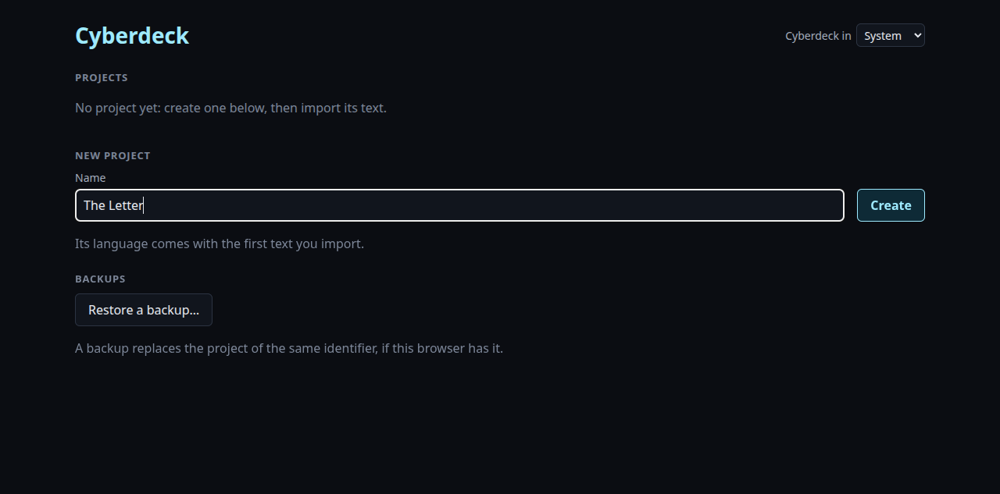

*The projects screen. Your projects are listed above the form once you have some.*

Cyberdeck saves everything as you go: there is no Save button to remember.

> **Tip**
>
> Cyberdeck speaks English and French. It follows your computer's language; the **Cyberdeck in** menu, on this screen or at the top of a project, changes it. Your players choose theirs in Datajack.

## 2. Write or paste your story

A new project opens on the **Import** tab. Paste your text there, or press **Open a document…** to read a Word (`.docx`) or text file. To see how it works first, press **Use the sample story**.

> **Tip**
>
> No text yet? **Start without a text** opens an empty chapter in the storyboard, where you write it page by page. More chapters and scenes come from **New chapter** and **New scene**, on the story's level of the **Storyboard**.

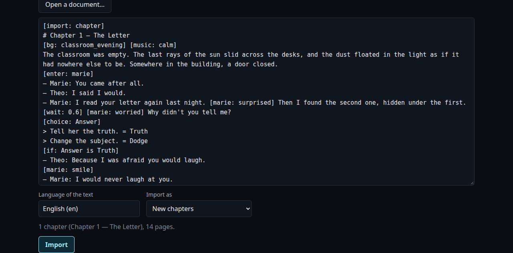

*As you type, Cyberdeck says what it understood: here one chapter of 14 pages.*

The rules are few:

| You write | It becomes |
|---|---|
| A paragraph | Narration. |
| `— Marie: You came after all.` | Marie speaks. Dialogue always starts with a dash, then the name, then a colon. |
| `— ???: Who's there?` | A voice nobody knows yet. |
| `# Chapter 1 — The Letter` | A new chapter, with its title. |
| `[something in brackets]` | A note for the stage or the story, never shown as text. |

You don't have to cut your text into pages. A page holds two lines, and Cyberdeck cuts long paragraphs by itself, between sentences when it can.

**Import as**, under the text, says where it goes: **New chapters** after those you have, **Pages at the end of a chapter** to continue one, or **In place of a chapter** to replace one with a new version. Cyberdeck picks the right one by itself most of the time; you only change it to continue a chapter.

Press **Import**. Your chapter appears in the **Storyboard**, on the story's own level: every chapter as a card, in the order they are played. Click one and its panel moves, renames, removes, exports or plays it; <kbd>Enter</kbd> opens it.

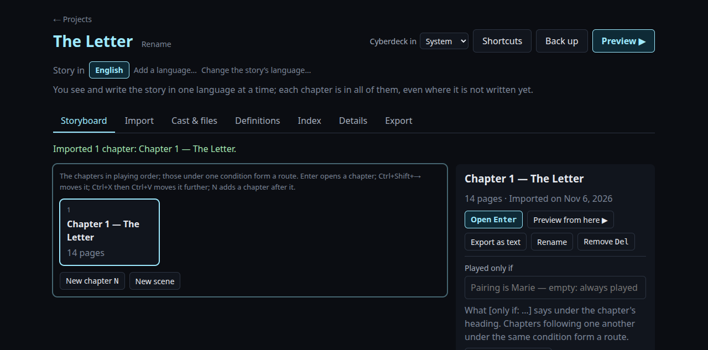

## 3. Set the stage

Brackets tell the stage what to do. A bracket alone on its line applies when the next page appears; one inside a sentence applies when the text reaches it.

```text
[bg: classroom_evening] [music: calm]
The classroom was empty.
[enter: marie]
— Marie: I read your letter. [marie: surprised] Then I found the second one.
[exit: marie]
```

| You write | What happens |
|---|---|
| `[bg: rooftop]` | The background changes. |
| `[music: calm]`, `[music: stop]` | A track plays in a loop, or stops. |
| `[enter: marie]` | Marie walks in. The first character stands on the left, the second on the right, the third in the middle. |
| `[marie: smile]` | Marie changes expression. |
| `[exit: marie]` | Marie leaves. |
| `[wait: 0.5]` | The text pauses for half a second. |

You never need to declare a character, a background or a track: naming it in the text creates it. If you mistype a word Cyberdeck knows, like `[backgound: …]`, it tells you instead of creating a character called “Backgound”.

## 4. Add pictures and music

In **Cast & files**, drop your images and sounds, or click to choose them. Each file goes where its name says:

| File | Goes to |
|---|---|
| `rooftop.jpg` | The background “rooftop” |
| `marie.png` | Marie's “normal” expression, the one she enters with |
| `marie-smile.png` | Marie's “smile” expression |
| `calm.mp3` | The track “calm” |
| `opening.webm` | The video “opening” (`.webm` or `.mp4`) |
| `opening.vtt` | Its captions, for players who want them |

Capitals, spaces, hyphens and underscores don't matter. Dropping a new file replaces the old one. A `.zip` holding all your files can be dropped as it is: it goes in as if you had unzipped it.

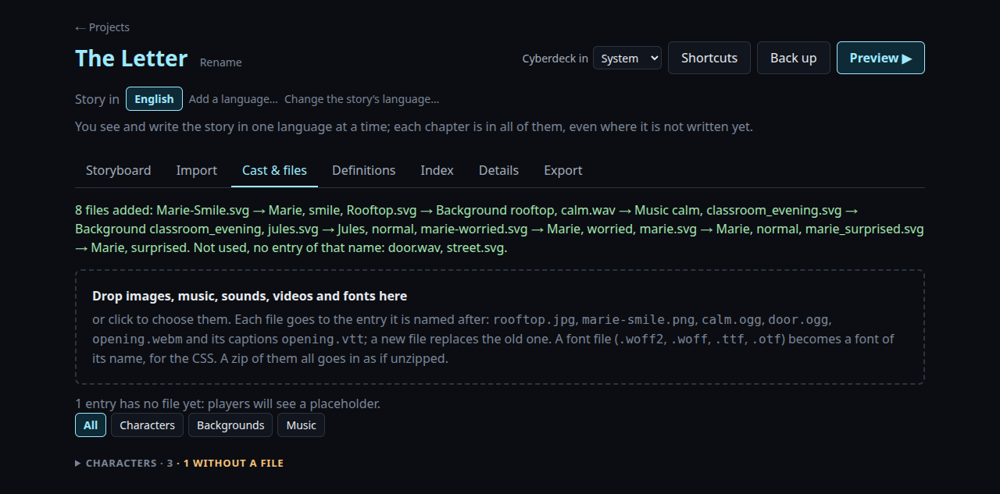

*Cyberdeck says where each file went, and which files matched nothing.*

> **Tip**
>
> Anything still without a file shows as a grey placeholder, so you can write first and draw later.

## 5. Play it

**Preview ▶**, at the top right, plays your game exactly as players will see it. Press <kbd>Esc</kbd> to come back.

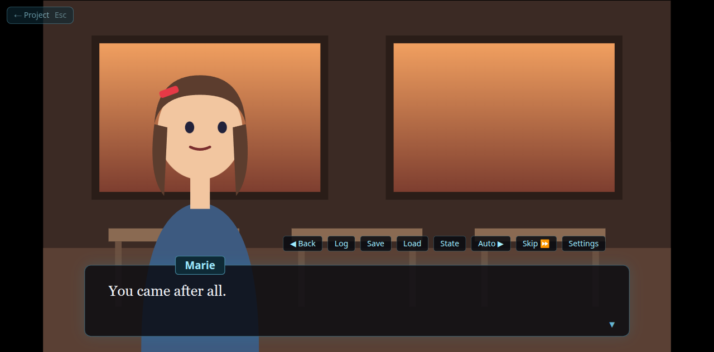

*The name plate stands above whoever is speaking.*

| To | Press |
|---|---|
| Go on | <kbd>Space</kbd>, <kbd>Enter</kbd> or a click |
| Go back | <kbd>←</kbd> or the mouse wheel up |
| Read what came before | <kbd>L</kbd> (the log) |
| Hide the text to see the picture | <kbd>H</kbd> or a right click |
| Skip what you have already read | <kbd>S</kbd> |
| Settings: text speed, volumes, keys | <kbd>O</kbd> |

## 6. Your story as cards

Open a chapter, and the **Storyboard** shows it as cards, read left to right and top to bottom. Each card is a page; the small ◧ and its number say how many stage notes come with it. <kbd>Esc</kbd>, or **↑ Story**, goes back up to every chapter.

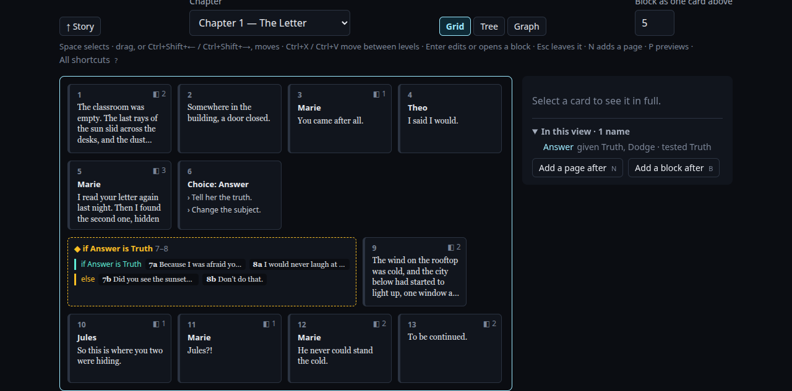

Click a card to see it in full on the right. Then:

- <kbd>Enter</kbd> edits it, as the text you would import;
- <kbd>N</kbd> writes new pages after it;
- <kbd>P</kbd> plays the game from there;
- drag cards to move them, and <kbd>Delete</kbd> removes them. <kbd>Ctrl</kbd>+<kbd>Z</kbd> undoes.

Everything also works without a mouse: the arrows move around, <kbd>Space</kbd> selects, and <kbd>Ctrl</kbd>+<kbd>Shift</kbd>+arrows move what is selected.

A block, an `[if]` or a `[loop]`, is one card in the grid. <kbd>B</kbd> adds a new one, ready for its condition; on a block, <kbd>Enter</kbd> opens it to work on its pages, and <kbd>E</kbd> edits its own text, its conditions and branches.

![Editing page 3: the text “— Marie: You came after all.” with the tag [enter: Marie] drawn as a chip, and a suggestion list offering Marie after typing “[Ma”.](images/page-edit.png)

*While editing, notes in brackets are drawn as chips, and typing `[` suggests what can go there.*

A note in brackets is one piece: <kbd>Backspace</kbd> removes it whole, and the arrows step over it. To change what it says from the keyboard, <kbd>Alt</kbd>+<kbd>←</kbd> or <kbd>Alt</kbd>+<kbd>→</kbd> steps into it.

While editing, **Insert tag** lists every kind of note, if you'd rather pick than type. <kbd>Ctrl</kbd>+<kbd>Enter</kbd> saves, <kbd>Esc</kbd> cancels. The card you are editing is marked ✎, and nothing you wrote is lost by accident: opening another card, another chapter or another tab first asks whether to **Save**, **Discard** or **Keep editing**.

> **Tip**
>
> Typing on the keyboard after clicking elsewhere? <kbd>Alt</kbd>+<kbd>G</kbd> brings you back to the cards, on what you had selected. While editing a page, it jumps between the text and its card. <kbd>Alt</kbd>+<kbd>Page Down</kbd> and <kbd>Alt</kbd>+<kbd>Page Up</kbd> go from tab to tab.

In a narrow window, the panel slides in from the right edge when you click a card or edit one; its handle, or <kbd>Alt</kbd>+<kbd>P</kbd>, puts it away.

## 7. Choices and branches

A choice gives a **decision** a value. Later, the story can depend on it:

```text
[choice: Answer]
> Tell her the truth. = Truth
> Change the subject. = Dodge
[if: Answer is Truth]
— Theo: Because I was afraid you would laugh.
[else]
— Theo: Did you see the sunset?
[end]
The wind on the rooftop was cold.
```

Each `>` line is an option: what the player reads, then `=` and the value it gives. Between `[if: …]` and `[end]` is what plays only in that case; `[else]` is for every other case, and `[else if: …]` tests something else. After `[end]`, everyone reads the same story again.

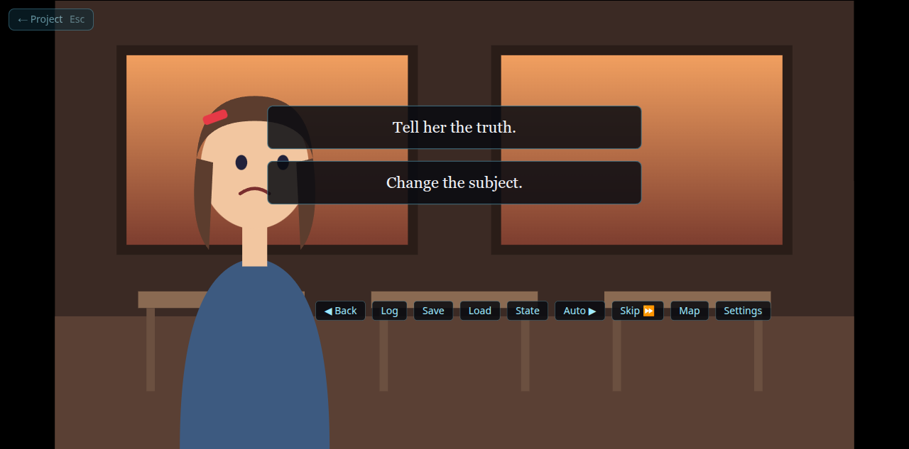

In the storyboard, an `[if]` is one block. Double-click it, or press <kbd>Enter</kbd>, to open it and see each branch on its own line. <kbd>Esc</kbd> goes back up.

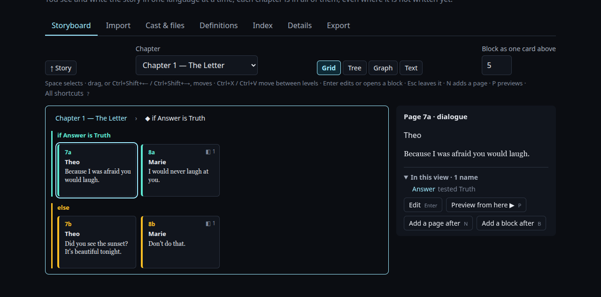

Conditions can combine: `[if: Answer is Truth and Mood is not Angry]`, or with `or`.

## 8. Share your game

In **Details**, add a description, credits and a cover picture: players see them in their library. Then, in **Export**, give the release a name and press **Export**. You get one `.zip` file: that is your game.

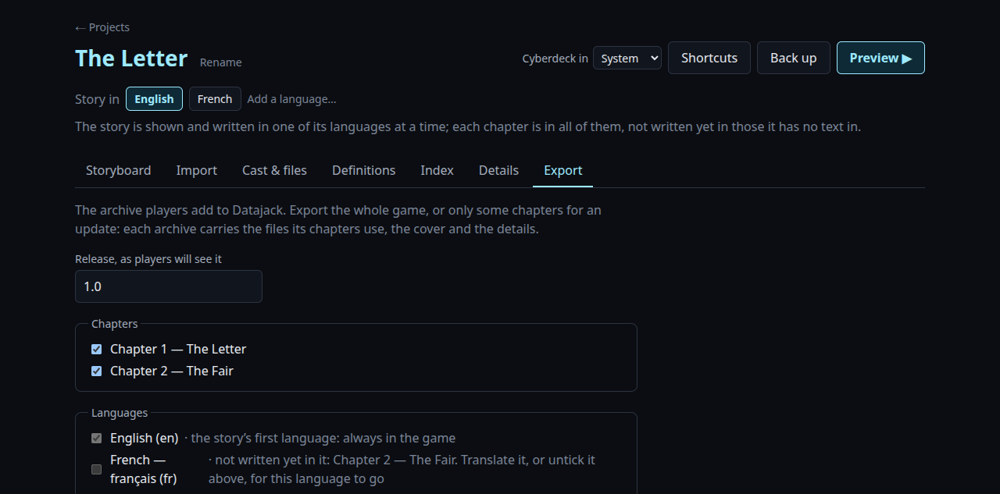

Players open Datajack, press **Add a game…** (or drop the file on it), and play.

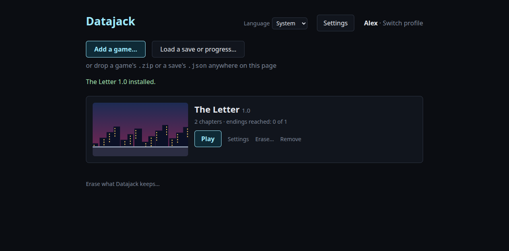

> **Tip**
>
> Writing chapter by chapter? Tick only the new chapters to make a small update. Players add it like a game, and it joins the one they have, their saves kept.

---

**Going further**

## 9. When the import finds a problem

Cyberdeck checks your text as you type, and lists what is wrong with its line number. An error must be fixed before importing; a warning only points out something that looks odd.

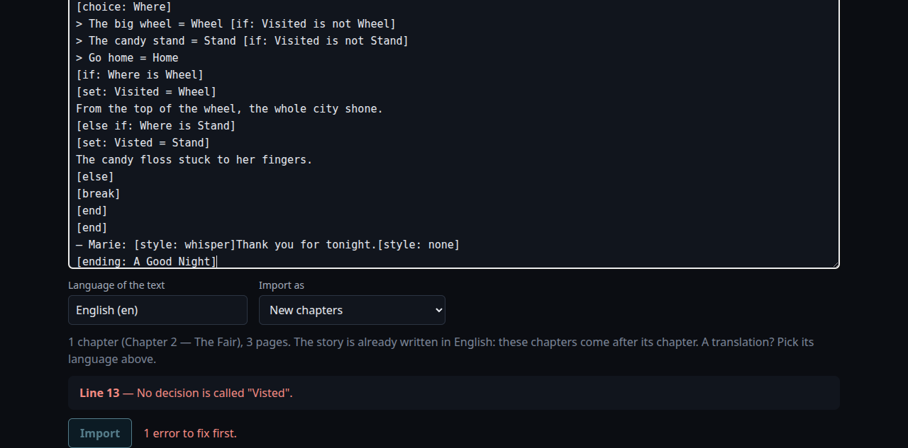

*A typo in a name: Cyberdeck knows every decision, ending and scene of the project.*

It also tells you about pages nobody can reach (every path before them has ended) and loops with no way out. In the storyboard, such pages are faded, and the blocks holding them say so.

## 10. Endings, and what players remember

```text
[ending: Alone]
```

The story ends there, with that name on the end screen. Players see how many of your endings they have found. A branch that ends stops there; one that doesn't carries on after its `[end]`. So several branches can share one ending: just write it after the block.

```text
[remember: The ghost's name]
…
[if: remembered The ghost's name]
— Marie: I know who you are.
[end]
```

Unlike decisions, what a player **remembers** stays across every new playthrough: for a story that knows you have been there before. `[if: seen ending Alone]` works the same way. `[forget: The ghost's name]` takes it away again, for good.

A counter or a decision can last too: `[counter lasting: Coins = 0]`, or `[decision multi
lasting: Bag = Key | Lamp]`. In a playthrough it behaves as any other, going back included, and the next playthrough starts with what the last one left. Use `[remember]` for what the game knows, whatever the player takes back; a lasting value for what the player carries.

Players can see some of this in their **Journal**, but only what you choose:

```text
[shown: Bag, Coins]
[shown after an ending: Trust, endings reached]
```

A decision shows while it holds something, a bag each item until it is taken away; a counter its number; `endings reached` the endings found. The second line waits until the player has reached an ending, for those hunting the others. Write these lines with your definitions, or choose in the Index, on a decision or a counter: **In the players’ journal**, and for the endings, at the top of the Index. Players read the names and values as you wrote them, in every language.

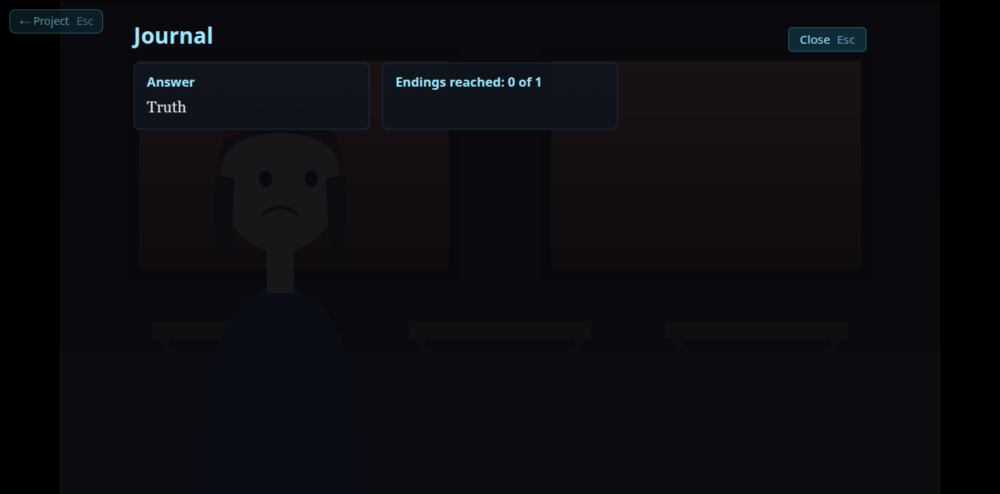

## 11. More about decisions, and counters

Until a choice sets it, a decision has no value: `[if: Answer is Truth]` is false, and `[if: Answer is not Truth]` is true. A new playthrough starts with none.

A decision normally holds one value, each new one replacing the last. To collect several, such as clues found or places visited, declare it with `multi`:

```text
[decision multi: Clues = Letter | Key]
[set: Clues = Letter]
…
[unset: Clues = Key]
```

`[set]` gives a value without asking the player. `[unset]` takes it away (the key was lost), and `[unset: Clues]` takes them all away.

What the story counts, such as affection, money or the rounds of a fight, is a **counter**. `[add]` adds 1, or the number after the name, and a condition compares it with a number:

```text
[add: Affection]
…
[add: Affection -1]
…
[if: Affection >= 3]
— Marie: I'm glad you came.
[end]
```

A counter starts at 0. To start it elsewhere, declare it: `[counter: Affection = 2]`. `[set: Affection = 0]` starts it over. Conditions can use `>`, `>=`, `<`, `<=`, `is` and `is not`. Like decisions, counters are saved with the game and undone by going back.

## 12. Keeping track of decisions

A decision or a style can be declared anywhere, and used everywhere. Two tabs keep them from getting lost.

**Definitions** holds the declarations that belong to no chapter in particular, as text. A declaration written in a chapter stays there, as a ◇ card in the storyboard; Definitions lists it with its place, and **Move to Definitions** brings it over. A decision made only by its choices is listed too.

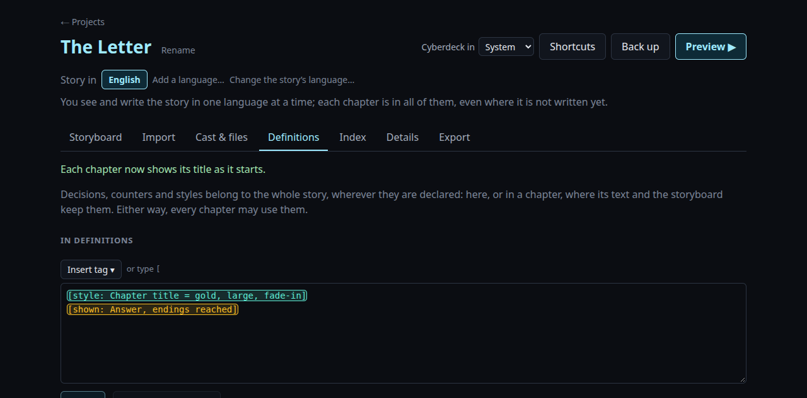

**Index** lists every decision, counter and memory, with every place it is given a value or tested. Click a place to see the card. At the top, it points out what looks forgotten: a value tested but never given, so that condition can never hold; an ending no path reaches; a memory nobody checks.

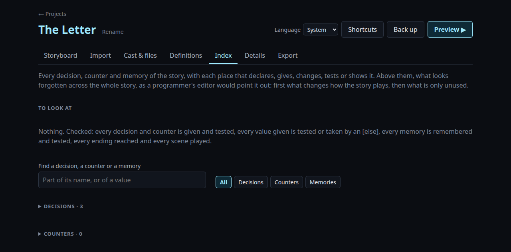

In the storyboard, **In this view**, under the panel, lists the decisions, counters and memories the cards on screen use. Inside an opened block, it's only that block's.

## 13. Places to come back to

For a hub the player returns to until they choose to leave, use a `[loop]`. It plays again and again until a `[break]`:

```text
[decision multi: Visited = Wheel | Stand]
[loop]
[choice: Where]
> The big wheel = Wheel [if: Visited is not Wheel]
> The candy stand = Stand [if: Visited is not Stand]
> Go home = Home
[if: Where is Wheel]
[set: Visited = Wheel]
From the top of the wheel, the whole city shone.
[else if: Where is Stand]
[set: Visited = Stand]
The candy floss stuck to her fingers.
[else]
[break]
[end]
[end]
```

An option followed by `[if: …]` is offered only while that holds: here, each place disappears once visited.

## 14. Scenes: write once, play anywhere

A bad end that can happen in chapter 2 and again in chapter 5 is written once, as a scene, and played wherever you need it. After a scene, the story goes on where it was, unless the scene ended it.

```text
# Chapter 2
[if: Answer is Lie]
[play: Caught]
[end]
The guard lets you pass.

# Scene: Caught
— Guard: Stop right there.
[ending: Caught]
```

## 15. Chapters of a route

A chapter that belongs to one route only says so right under its title. Other players pass it by:

```text
# Chapter 3 — Marie's route
[only if: Route is Marie]
```

On the story's level of the storyboard, chapters following one another under the same condition form a route, framed together, the condition written once. In a chapter's panel, **Played only if** sets its condition; **Apply to its route** sets it for every chapter of the route at once.

## 16. Characters on stage

| You write | What happens |
|---|---|
| `[enter: marie right smile]` | Where she stands and how she looks. Places: `far-left`, `left`, `center`, `right`, `far-right`, or `35%` of the width. |
| `[move: marie center]` | She walks over. |
| `[enter: jules slide-from-right 0.8s wait]` | He slides in; `wait` holds the text until he arrives. |
| `[exit: marie fade 1.5s]` | She fades out slowly. |
| `[enter: marie near]`, `far` | Closer (larger, in front) or further away. |
| `[enter: marie facing-left]` | Which way she looks. By default characters look towards the middle. |

In **Cast & files**, tell Cyberdeck which way each character was drawn looking, and it turns them the right way.

## 17. Sounds, voices, videos and screen effects

| You write | What happens |
|---|---|
| `[sound: door]` | A sound plays once. Its file is named after it: `door.ogg`. |
| `[voice: marie-01]— Marie: Hello.` | Marie's line is heard: `marie-01.ogg`. It stops when the player moves on, and plays again if they come back to the page. |
| `[video: Opening]` | A video fills the screen, and the text waits until it ends. Clicking or pressing Space passes it. Captions go in a file named like it, `Opening.vtt`. |
| `[transition: fade]` | The next background fades in. Also `black` or `white`, with a duration: `[transition: black 1.5s]`. |
| `[shake]`, `[shake: strong]` | The screen trembles. |
| `[flash: red]` | A flash of colour. |
| `[fade out: 1s]` … `[fade in: 1s]` | The screen goes black (or `white`), the text showing over it. |
| `[tint: sepia]`, `night`, `grey`, `none` | Colours the whole picture, for a memory or a night. |

Inside a sentence, a sound, shake or flash plays when the text reaches it.

## 18. How the text looks

Give a style a name and what it looks like, then use it inside the text:

```text
[style: Whisper = italic, small, grey]
— Marie: [style: whisper]Don't tell anyone.[style: none] Promise?
```

The looks to pick from: `italic`, `bold`, `small`, `large`, `grey`, `red`, `blue`, `green`, `gold`, `shaking`, and three that appear as the text is typed: `fade-in`, `rise`, `glow`. One alone needs no name: `[style: italic]`. Italics in a Word document are kept.

For anything else, **Definitions** takes CSS. Each class is a style:

```text
.ghost {
  color: #8af;
  text-shadow: 0 0 6px #8af;
}
```

…and `[style: ghost]` draws it. For a font of your own, drop its file (`.woff2`, `.ttf`…) in **Cast & files**, then name it: `font-family: "Cinzel"`. The game carries it to your players. Only how text looks is kept. Anything that would load a file, or touch the player's own buttons, is left out, and the tab says what and why. Text in a larger style is cut into shorter pages, so it always fits the box.

**Title cards**, in Definitions, show each chapter's title over the stage as it starts. Give them a look with a style named `chapter title`, and the ending's name with one named `ending`.

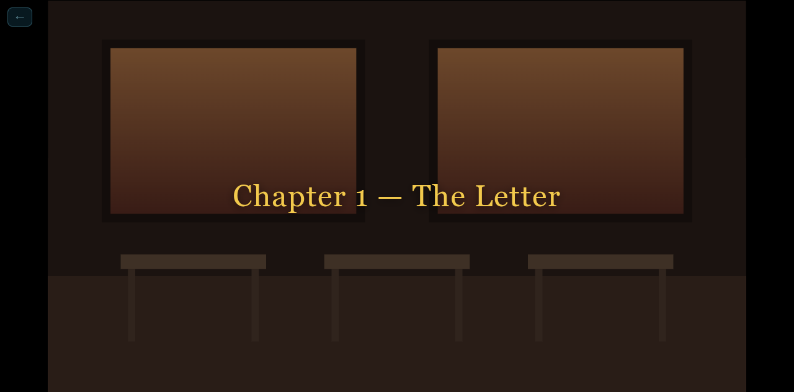

For long narration, `[text: full]` writes over the whole screen, as in a book, the pages piling up until `[clear]`. `[text: box]` brings the text box back.

## 19. Illustrations and the gallery

```text
[illustration: Sunrise]
…
[illustration: none]
```

A full-screen picture of a key moment. Players find the ones they have seen in the game's **Gallery**, in their library; the others stay locked.

## 20. Working in Word

You can write your whole story in Word and open the `.docx` in the Import tab. Titles in the “Heading 1” style become chapters. A dialogue line that Word turned into a bulleted list is still dialogue.

To edit in Word again later, **Export as text** (in a chapter's panel, on the story's level) writes the story back with every change you made in Cyberdeck. Import it again, and Cyberdeck chooses **In place of a chapter** by itself, for the chapter of the same title: its first line, `[import: chapter]`, says it is one. The chapter keeps its place, and players' saves inside it keep working.

Exported as is, each page is a paragraph, so that it comes back cut the same. To send a text to a translator, choose **As written** under **Paragraphs**, in the Export tab: the pages cut from one paragraph are joined again, and the text reads as you wrote it.

## 21. Tree view, shortcuts and backups

The grid keeps each block folded, to see the whole chapter at a glance and move things around. The storyboard's **Tree** view unfolds everything instead: one card per line, the branches of each block side by side, to follow how the story goes. Here is the fair of chapter 2 in both views.

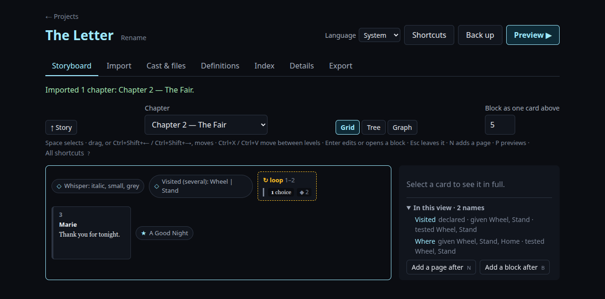

*The grid: the loop is a single block. Double-click it to open it.*

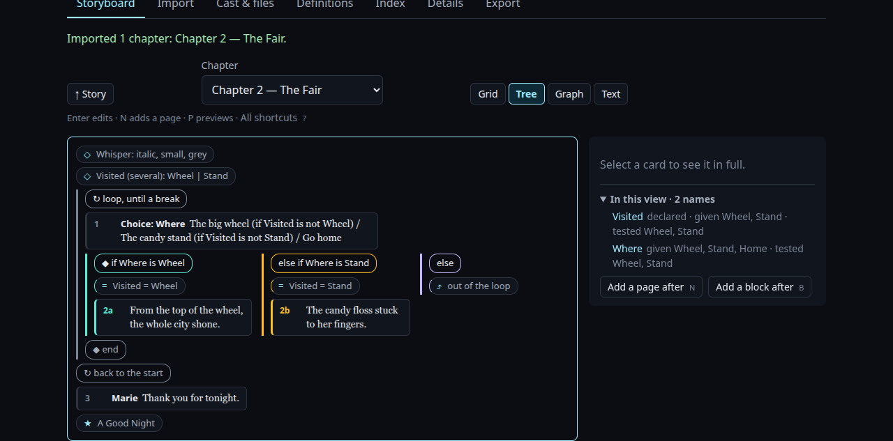

*The tree: the loop, its choice and its three branches, all at once. Cards are edited here, not moved.*

The **Graph** view draws the whole story as a map: chapters one under the other, blocks forking into their branches and joining again, endings where routes stop, and scenes on the side, linked to each `[play]` that calls them. Drag it to move around, use the wheel to zoom, and click a box: its panel opens it in the grid, adds a branch to a block or an option to a choice, or moves a branch.

From the keyboard, <kbd>Tab</kbd> goes from box to box, bringing each into view, and <kbd>Enter</kbd> selects the one reached and moves to its panel, where <kbd>Tab</kbd> goes through its buttons; <kbd>Esc</kbd> comes back to the box. On the map itself, the arrows move it around, and <kbd>+</kbd> and <kbd>−</kbd> zoom in and out.

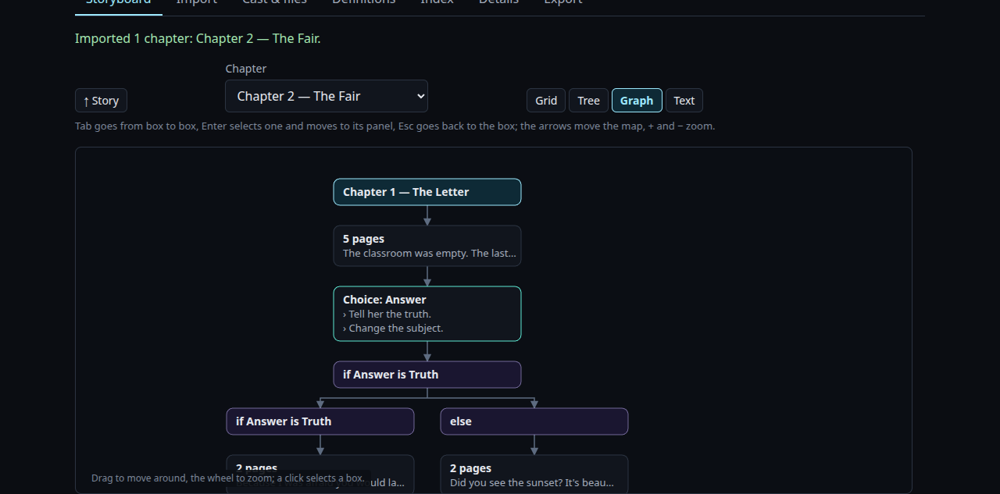

**Shortcuts** (or <kbd>?</kbd>) lists every key by screen; click one to change it.

**Back up** downloads your whole project as one file. **Restore a backup…**, on the projects screen, brings it back, on this computer or another. Do it now and then.

## 22. What your players see

Players have their own **Settings**, in three categories. **General**: text speed, volumes (music and videos, sounds, voices), the speed of auto mode, full screen. **Accessibility**: larger text, a plainer font, a stronger contrast, pages read aloud, choices that wait for them, and captions on videos. Players with a screen reader hear each page whole as it appears. **Controls**: their own keys. You have nothing to do for any of it: it works in every game.

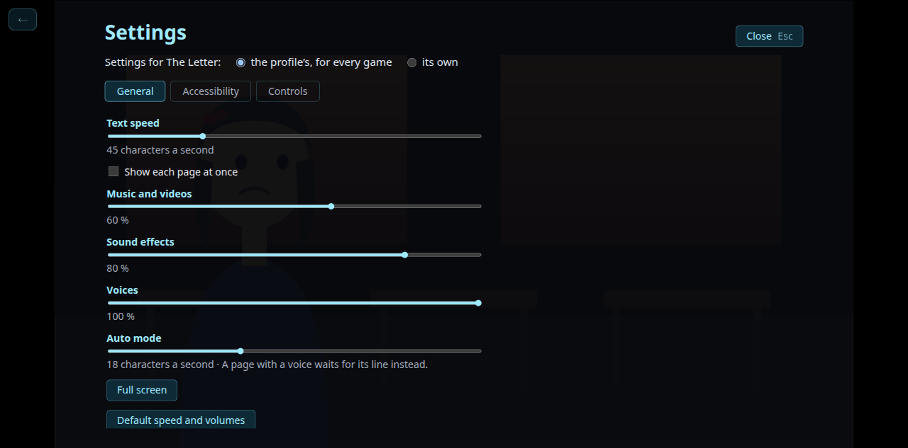

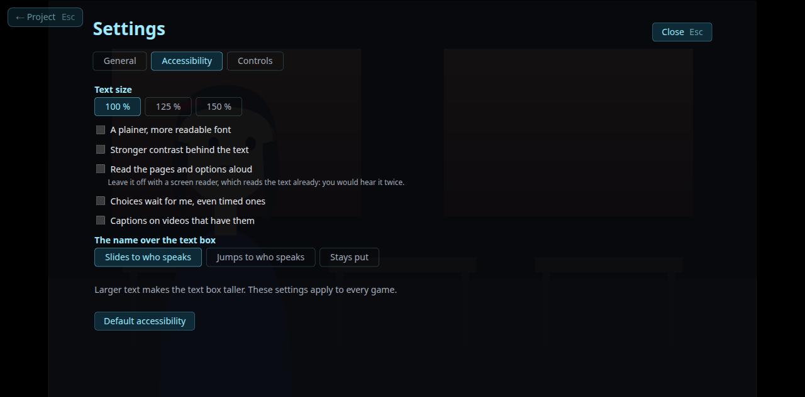

The **Log** shows what they read and picked. Clicking a line goes back to it. The **Journal** (<kbd>J</kbd>) shows what you chose to let them see (see section 10). A game in several languages asks which one, on its card in the library: **Play in**.

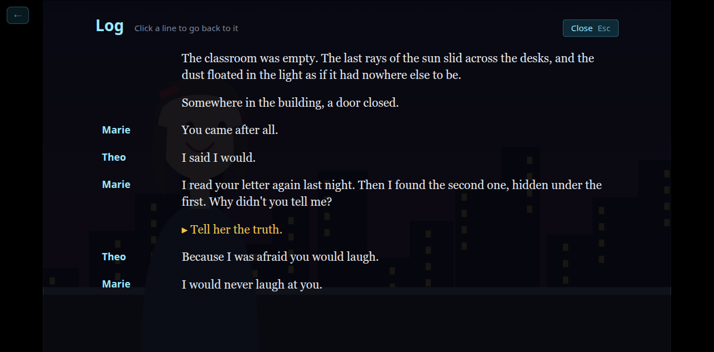

The game saves at every page. Save and Load add six slots, and **Save to a file** keeps a save as a file, to put aside or to carry to another computer. There, **Load a save…** in the library opens it, if the game is installed. Each save shows a small picture of the stage as it was. The **Map** shows each choice they have reached and where each option led, so that they can try another from there.

**Auto ▶** moves on by itself: a page with a voice waits for its line, another for the time it takes to read it. Any key or click takes over again.

The look of the text box and of the names is yours to set, too. Images named `text-box.png` and `name-plate.png`, dropped in Cast & files, frame them, stretched by their edges so that their corners stay whole: a floral border, for instance. In the CSS, `.text-box` and `.name-plate` change their colours, borders and shadows, and a class named after a character, `.marie`, her plate alone; or give her name a colour in Cast & files. In the preview, **State** shows what the story holds on the page shown: each decision, counter and name, what is remembered.

## 23. The player's name, and timed choices

To let players name the hero, ask for it, then write the name between braces wherever it goes:

```text
[ask: Hero = Alex]
— {Hero}: So that's my name.
Marie looked up. “{Hero}? Is that you?”
```

The story stops on a small box to type the name, at most 12 letters. `Alex` stands in until they give one, or if they leave it empty.

A choice can have a time limit. Write it after its name, and end one option with `[timeout]`: it is what happens when time runs out. Players see it among the others, the time running out along it, so they know what waiting means, and can pick it without waiting.

```text
[choice: Answer 10s]
> Tell her the truth. = Truth
> Lie. = Lie
> … = Silent [timeout]
```

Any option can be it: with `> Yes. = Accept [timeout]`, waiting means yes.

> **Tip**
>
> Players who need more time can ask choices to wait for them, in their settings: nothing is then taken by itself.

## 24. Values in the text, and chance

Braces show a value the story keeps: a counter, a decision, a name the player gave.

```text
[counter: Hour = 8]
[decision multi: Clues = Letter | Key]
It is {Hour} o'clock. In your pocket: {Clues}.
```

A decision shows its values, separated by commas. A name that means nothing to the story is reported when you import, so a typo never shows; one name means one thing, so a name asked of the player cannot also be a counter's. To write a brace itself, double it: `{{`.

For a counter, `[set: Weather = random 1 6]` draws a number between the two, so that the same choices may lead elsewhere. A save keeps what was drawn, and going back draws the same again.

## 25. Translating your story

A translation lives in the same project, beside your story: the same chapters, pictures and sounds, the same decisions, its own text. Say which language a text is in on its first line, with its standard code, and import it as usual:

```text
[import: story fr]
# Chapitre 1 — La Lettre
…
```

Or pick it under **Language of the text**, in the Import tab, by its name or its code. A whole story, `[import: story fr]`, lays its chapters over yours, in order: its first chapter is your first chapter in French. Chapters imported on their own fill the first places not translated yet, and the Import tab says which before you import; to put one elsewhere, choose **In place of a chapter**. A chapter not translated yet shows *hollow* on the story's level, your title standing in. Scenes go by their name, which stays as it is, as the tags do: `[bg: rooftop]`, `[enter:
marie]`, the names of decisions and their values. What players read of an ending can be translated:

```text
[ending: The Empty Room = La Chambre vide]
```

**Story in**, at the top of the project, shows the story in one language at a time; **Add a language…** begins another, and **Remove this language** takes one out again while it has no text. While your story has only one language, **Change the story's language…** sets it right, if Cyberdeck guessed wrong. In the Export tab, tick the languages players get: one with a hollow chapter cannot go yet, and the tab says which chapter it lacks. Exporting the story as text writes its language on the first line, so that a translator's version comes back as one.

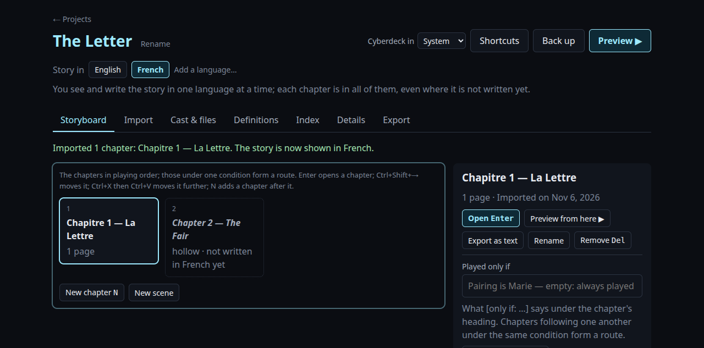

## 26. Recipes for bigger stories

A few ways to put the pieces together, for stories that branch more than once.

### Routes that meet at the end

Each route is a run of chapters under its own condition; the epilogue has none, so every route reaches it, and its own `[if]` says goodbye in each one's way.

```text
# Chapter 3 — Marie
[only if: Route is Marie]
…
# Chapter 3 — Jules
[only if: Route is Jules]
…
# Epilogue
[if: Route is Marie]
— Marie: Same time next year?
[else]
— Jules: Don't be a stranger.
[end]
[ending: Together]
```

### Affection deciding the route

A counter per character, raised by the options that please them, then read once, where the route starts:

```text
[choice: Gift]
> Flowers = Flowers [add: Marie]
> A book = Book [add: Jules]
…
[if: Marie >= 3]
[set: Route = Marie]
[else]
[set: Route = Jules]
[end]
```

### A hub where time runs out

A loop around a choice, a counter for the hour, and a way out when it is late:

```text
[counter: Hour = 18]
[loop]
[if: Hour >= 22]
The fair is closing.
[break]
[end]
[choice: Where]
> The big wheel = Wheel
> The candy stand = Stand
[add: Hour]
It is now {Hour} o'clock.
[end]
```

### A choice that remembers

A `[decision multi]` keeps each option picked; an `[if]` after an option hides the ones already taken, as in the fair above.

### An ending for those who saw the others

What the player has seen stays with their profile from one playthrough to the next. A true ending can wait for both routes:

```text
[if: seen ending Marie's Ending and seen ending Jules's Ending]
[play: The Truth]
[end]
```

### Scenes as pieces to reuse

A scene can be played by many chapters, and test the story itself: one morning scene for every day, its lines changing with what happened.

```text
# Scene: Morning
[bg: kitchen]
[if: Hour >= 9]
— Mum: You're late again.
[else]
— Mum: Breakfast is ready.
[end]
```

### A second playthrough

`[remember]` marks what the profile keeps for good. Later, `[if: remembered …]` lets a character notice:

```text
[if: remembered The ghost's name]
— Ghost: You came back, and you know my name.
[end]
```

### What the game knows, and what the player carries

A character can notice the player went back, because a memory stays whatever they take back:

```text
[remember: Saw the letter]
…
[if: remembered Saw the letter]
— Marie: You read it, didn't you? Even if you pretend you didn't.
[end]
```

A key found in one playthrough can be there in the next, with a lasting decision, and gone once used:

```text
[decision multi lasting: Bag = Key | Lamp]
[shown: Bag]
…
[set: Bag = Key]
…
[if: Bag is Key]
The door opens.
[unset: Bag = Key]
[end]
```

Money that adds up over playthroughs is a lasting counter, `[counter lasting: Coins = 0]`, and `[add: Coins 10]`. A promise broken for good is a memory forgotten: `[forget: Promised to
stay]`.

### Waiting as an answer

Silence that means yes:

```text
[choice: Stay 8s]
> I'll stay. = Yes [timeout]
> I have to go. = No
```

### A journal that opens up

Show little at first, and more once the player has seen an ending, for those hunting the others:

```text
[shown: Bag]
[shown after an ending: Trust, endings reached]
```

### A story in two languages

Write it in your language, then lay the translation over it, chapter by chapter, as section 25 shows. Ship it once every chapter has its translation: players pick their language on the game's card.

### A little chance

A random draw lets the same choices lead to different evenings:

```text
[counter: Weather]
[set: Weather = random 1 6]
[if: Weather >= 5]
[bg: rain]
It started to pour.
[end]
```

The **Graph** view of the storyboard is the place to check the whole: every route, where it forks, where it ends.
